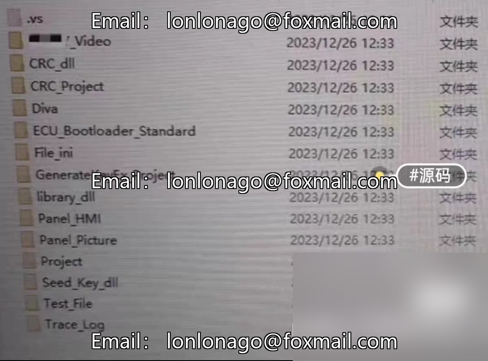
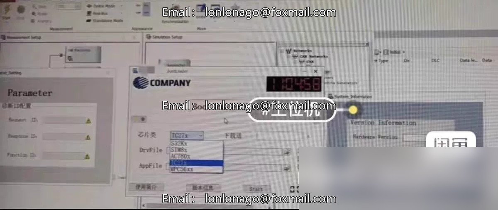

# UDS Boo based on Canoe's CAPL language

## Body

UDS Boo based on Canoe's CAPL language

Upper-level program flashing using UDS bootloader based on CAPL language with canoe.

Program Main Functions
1. Support for ISO15765 communication
2. Support for binary file parsing in BIN, HEX, S19 formats
3. Second-level development capability
4. Customizable flashing process
5. Security algorithm is implemented by calling dynamic link libraries (DLLs), ensuring secure flashing
6. Data integrity verification during flashing to prevent incomplete flashing data
7. Well-known automotive companies' mass production programs, stable and reliable

## Images

## Payment

Here is a pay link on Stripe ( https://buy.stripe.com/3cs8yP7sY87d0vu9AB ). Please contact me lonlonago@foxmail.com after funding $89, and I will send you a complete data files , thank you!

